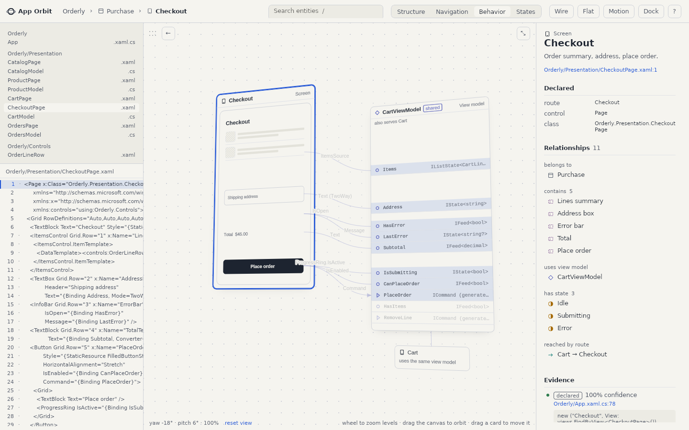

# App Orbit

**A spatial inspector for Uno Platform apps.** Before you change a screen in code you didn't
write, App Orbit shows you everything it touches: the view model behind it, the members each
control binds to, the states it can be in, the routes in and out, and the shared components
it reuses. You zoom from the whole app down to a single property, and every fact links to the
source line it came from.



**Status: working prototype.** It runs on hand-written maps of two sample apps. Generating
that map from a real codebase is the next step, and the reason it lives in this repository.

---

## Where to start

| You want to | Go to |
|---|---|
| See it running in two minutes | [Run the desktop app](#run-the-desktop-app) below |
| Watch it without building anything | [`App/media/app-orbit-scenario.mp4`](App/media/app-orbit-scenario.mp4), 72 seconds with captions |
| Demo it to someone | [`App/DEMO.md`](App/DEMO.md), a four-minute script built around a bug ticket |
| Understand how the Uno app is built | [`App/README.md`](App/README.md), then [`App/SPEC.md`](App/SPEC.md) |
| Know what is finished and what is not | [`App/COMPLETENESS.md`](App/COMPLETENESS.md) |
| Change the graph format | [`graph/app-graph.schema.json`](graph/app-graph.schema.json) and [`scripts/validate_graph.py`](scripts/validate_graph.py) |
| Work on the browser prototype | [`PROTOTYPE.md`](PROTOTYPE.md) |

## How it relates to Atlas

App Orbit is the main project in this repository. Atlas, the legacy projects at the repository
root, answers a neighbouring question, and its extractor is App Orbit's way to real source.

| | Atlas | App Orbit |
|---|---|---|
| Question | How do I move between screens? | What does this screen depend on? |
| Depth | Screens and routes | Screens, view models, members, bindings, commands, states, components |
| Input | Extracted from real source with Roslyn, plus a live runtime feed | A hand-written graph file |
| Evidence | Declared, observed, unreachable | Declared, observed, derived, inferred, each with a confidence and a source line |

Both treat code as the source of truth and mark where every edge came from. App Orbit started
from the Atlas idea and went one level deeper into each screen; Atlas already has the part App
Orbit lacks, real extraction.

**The obvious next step** is an importer: run `atlas extract` on an app, turn its `AppModel`
into an App Orbit graph, and get screens, routes and flow triggers for free. A trial run on
`samples/RoundsApp` gives 13 screens and 23 declared edges, 11 of them flow triggers labelled
with their button text ("Sign in", "Start rounding").
View models, members and bindings would still need new extraction work in
`Atlas.Extraction`.

## What is in this folder

```
AppOrbit/
  App/                  the Uno Platform desktop app (start here for code)
    AppOrbit/             the project: Graph, State, Layout, Scene, Dock, Figure, Shell, Themes
    tools/                parity check, headless journey, stress runner, video recording
    shots/                one screenshot per journey stop, refreshed by each run
    media/                the recorded walkthrough
    DEMO.md  SPEC.md  COMPLETENESS.md  README.md
  graph/                the app graphs every renderer reads
    orderly.graph.json    sample 1: a 5-screen ordering app (73 nodes, 118 edges)
    fieldwork.graph.json  sample 2: an 8-screen field-service app (132 nodes, 216 edges)
    app-graph.schema.json the format
  scripts/              validate_graph.py, fieldwork_graph.py, stress_graph.py (Python, stdlib only)
  index.html  css/  js/ the browser prototype, the design reference the Uno app is checked against
  tests/                the prototype's Playwright smoke test and its screenshots
  figures/              the exploded-view and Hairline illustrations
  SPEC.md               the original architecture, design and interaction briefs
  PROTOTYPE.md          the prototype's full guide
```

The browser prototype came first and still defines correct behaviour: the Uno app's layout is
checked against the prototype's own JavaScript on every case.

## Run the desktop app

Needs the .NET 10 SDK. The app pins its own Uno.Sdk (6.7.30) in `App/global.json`.

```powershell
cd AppOrbit\App
dotnet run --project AppOrbit\AppOrbit.csproj -c Release -f net10.0-desktop
```

Use **Release** when launching outside Visual Studio: a Debug build waits for the Hot Design
server. To open the second sample app instead of Orderly:

```powershell
$env:APP_ORBIT_GRAPH = (Resolve-Path ..\graph\fieldwork.graph.json)
dotnet run --project AppOrbit\AppOrbit.csproj -c Release -f net10.0-desktop
```

Keys to try: `1`–`4` switch lens (Structure, Navigation, Behavior, States), `/` searches,
`Backspace` zooms out, `Alt`+`←` goes back, `D` docks the viewer, `?` lists the rest.

### Run the browser prototype

```powershell
cd AppOrbit
.\serve.ps1        # serves on :8787 and opens the browser
```

## How it is built, in one paragraph

One Uno project, `net10.0-desktop`, Skia renderer. The shell (toolbar, mock editor, inspector,
search) is XAML; the 3D viewer is one `SKCanvasElement` that draws every card through the same
camera maths the prototype's CSS used. State is one immutable `AppState` record behind one
`Store`, and the scene is a pure function of it: `Layout.Compute(graph, state)` returns cards
and links, the canvas paints them. Details and the reasoning are in [`App/SPEC.md`](App/SPEC.md).

**Conventions differ from Atlas.** `docs/CLAUDE.md` asks for MVUX and Material styling.
App Orbit uses a single store because its state is synchronous and frame-coupled, and its own
token set (`App/AppOrbit/Themes/Tokens.xaml`, light and dark) because it mirrors the
prototype's CSS tokens. Keep App Orbit's conventions inside `AppOrbit/` and Atlas's everywhere else.

## How we know it works

Every check below last ran on Linux, inside this repository. Commands start from `AppOrbit/`.

| Check | What it proves | Command | Last result |
|---|---|---|---|
| Graph validator | Every id, edge and source line resolves | `python scripts/validate_graph.py graph/orderly.graph.json` | Both graphs pass |
| Layout and search parity | The C# layout and search match the prototype's JavaScript exactly | `cd App; dotnet run --project tools/LayoutCheck` | 0 differences: Orderly 888 cases and 175 searches, Fieldwork 1,596 and 299 |
| Journey | The app drives its own store through every surface and checks the result | `cd App; tools/run-xvfb.sh` (add `dark` for the dark theme) | 75 / 75, both themes |
| Prototype smoke test | The browser prototype still passes its own journeys | `npm run serve`, then `npm test` | 65 checks pass |
| Stress | Speed, memory and stability at scale | `cd App; tools/run-stress.sh <graph> <log>` | Passes up to a generated 200-screen app (8,226 nodes) |

The journey and stress scripts need Xvfb (Linux). On Windows, run the app and walk through
`App/DEMO.md` by hand.

## Known limits

- **The graphs are hand-written.** Nothing reads a real codebase yet; see the importer above.
- **Not yet run on Windows.** Every automated check ran on Linux under Xvfb. Windows is the
  target, so rehearse there before any demo.
- **Mouse-wheel zoom is unverified.** Uno's X11 host reads the wheel through XInput 2, which
  the headless display does not provide. Test it by hand on Windows.
- **No live values.** The inspector says so: no running app is connected. Atlas's runtime
  agent is the natural source for that later.
- **A small framework leak remains.** Uno keeps a weak reference for every element that uses a
  shared brush. The app avoids shared brushes where it builds content in code, which cut the
  growth tenfold (about a quarter of a kilobyte per action), and managed memory levels off in the
  stress runs. Details in `App/COMPLETENESS.md`.

## Credits

The exploded-view figure follows Cathryn Lavery's
[diagram-design](https://github.com/cathrynlavery/diagram-design) skill, and the interactive
figures are built with Lucas Marques's [hairline](https://github.com/lucasmarkes/hairline).
Both are MIT and vendored unchanged; see [`PROTOTYPE.md`](PROTOTYPE.md#figures).
